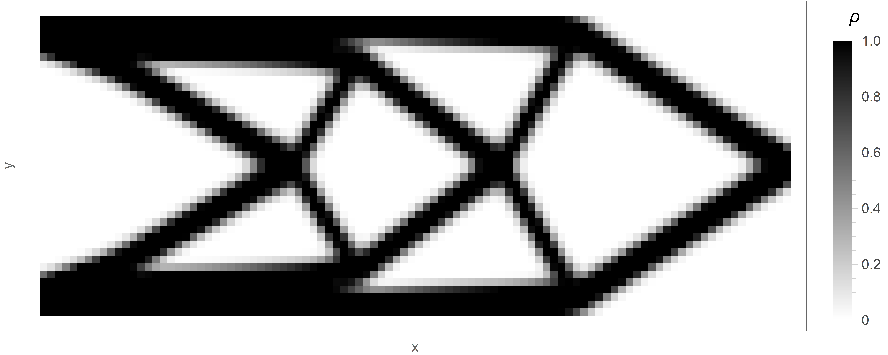
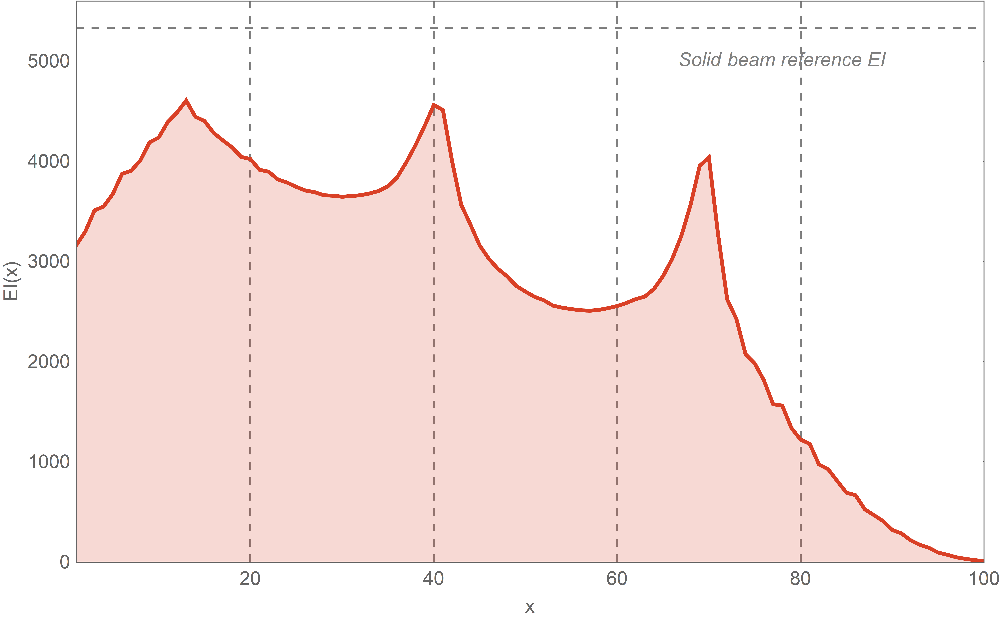
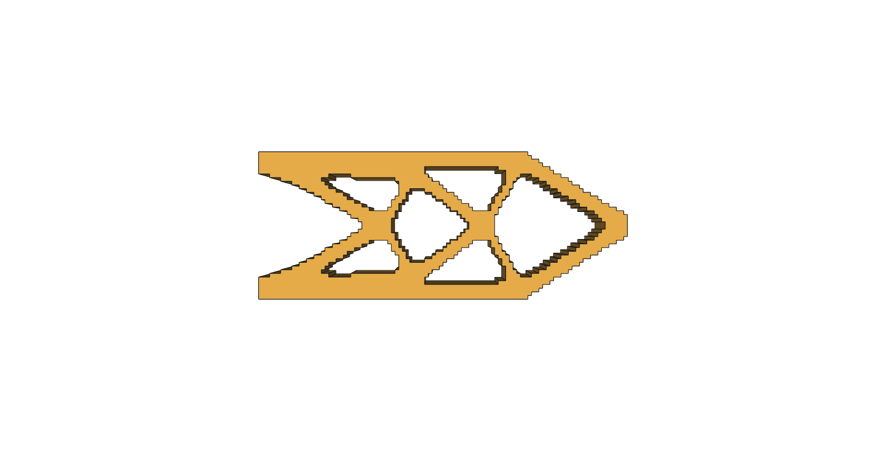
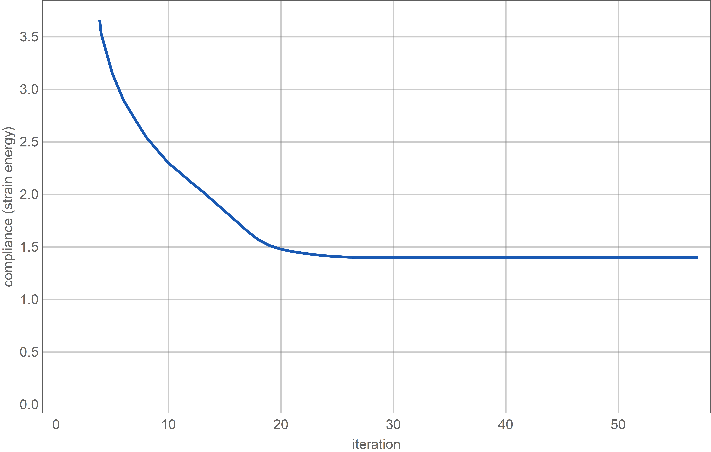

# Topology Optimization

**Topology optimization of a cantilever beam in Wolfram Mathematica (SIMP + optimality criteria), with spanwise bending-stiffness evaluation, an FE load test with stress visualization, and STL export of the optimized design.**

A compact, self-checking Mathematica notebook for minimum-compliance topology optimization on a 5:2 cantilever. It follows the classical density-based approach (SIMP penalization, sensitivity filter, optimality-criteria update) and adds post-processing that is useful for a beam-type structure: the cross-sectional bending stiffness $EI(x)$ along the span, a stress plot of the final design, and a watertight 3D mesh for CAD or 3D printing.

Only long-standing core functions are used.

## Problem

Minimize the compliance of a clamped beam under a vertical point load, subject to a volume constraint:

```math
\begin{aligned}
\min_{\rho} \quad & c(\rho) = \mathbf{F}^{\mathrm{T}} \mathbf{u} \\
\text{s.t.} \quad & \mathbf{K}(\rho) \mathbf{u} = \mathbf{F} \\
& \frac{1}{N} \sum_{e=1}^{N} \rho_e \le V^{\ast} \qquad (\text{default } V^{\ast} = 0.4) \\
& 0.001 \le \rho_e \le 1
\end{aligned}
```

| Item | Setting |
|---|---|
| Domain | Rectangle, aspect ratio 5:2, default 100 × 40 elements |
| Elements | Bilinear Q4, plane stress, unit thickness, element size 1 |
| Supports | Left edge fully clamped |
| Load | Vertical point load at mid-height of the right edge (split over two nodes if the number of element rows is odd) |
| Material | $E_0 = 1$, $E_{\min} = 10^{-9}$, $\nu = 0.3$ (dimensionless) |

## Method

- **SIMP interpolation:** $E_e = E_{\min} + \rho_e^{p}(E_0 - E_{\min})$, $p = 3$.

- **Sensitivities:**

  $$\frac{\partial c}{\partial \rho_e} = -p\rho_e^{p-1}(E_0 - E_{\min})\;\mathbf{u}_e^{\mathsf{T}}\mathbf{K}_e\mathbf{u}_e$$

- **Sensitivity filter** (mesh-independence): weights $`H_{ef} = \max\big(0, r_{\min} - \mathrm{dist}(e,f)\big)`$, default $r_{\min} = 1.6$ elements, built once as a sparse matrix.

- **Optimality-criteria update** with bisection on the Lagrange multiplier, move limit $0.2$, lower bound $0.001$.

- **Stopping criterion:** $\max_e \lvert \Delta\rho_e \rvert < 0.01$ after more than 15 iterations, or `maxIter`.


- ## Notebook structure

Evaluate the cells from top to bottom. All parameters are at the top of the first cell.

| Cell | Content |
|---|---|
| 1 | Parameters, element stiffness matrix with self-tests, mesh and boundary conditions, assembly operators, filter, OC update, optimization loop, analysis of the final design |
| 2 | Bending stiffness $EI(x)$ per cross-section, plots: topology (density), $EI(x)$ along the span, convergence history |
| 3 | STL export of the optimized design |
| 4 | FE load test of the final design: deformed shape colored by $\sigma_{xx}$, with an equilibrium check |

Cells 2–4 only depend on cell 1 and can be run independently of each other.

### Main parameters

| Symbol | Default | Meaning |
|---|---|---|
| `nelx` | 100 | Elements along x (`nely = Round[2 nelx/5]`) |
| `volfrac` | 0.4 | Target volume fraction |
| `penal` | 3 | SIMP exponent |
| `rmin` | 1.6 | Filter radius in elements |
| `maxIter` | 30 | Maximum number of iterations |
| `move` | 0.2 | OC move limit |



## Post-processing

**Bending stiffness $EI(x)$.** For every column of elements, the neutral axis is taken as the modulus-weighted centroid

$$\bar y(x) = \frac{\sum_j E_jy_j}{\sum_j E_j}, \qquad EI(x) = \sum_j E_j\left(\frac{1}{12} + \big(y_j - \bar y\big)^2\right)$$

with the SIMP stiffness $E_j$ of each element and unit element size. It is compared with the solid-beam reference $E_0n_y^3/12$. $EI(x)$ is a geometric indicator computed from column sums; for truss-like topologies it is not the exact bending stiffness of the structure.



**FE load test ($\sigma_{xx}$).** The FE solution of the final design is scaled to a chosen test force. Strains are evaluated at the element centre and the plane-stress normal stress is computed as

$$\sigma_{xx} = \frac{E_e}{1-\nu^{2}}\big(\varepsilon_{xx} + \nu\varepsilon_{yy}\big)$$

using the penalized element modulus. The deformed mesh is drawn with an adjustable magnification factor. As a check, the bending moment obtained by integrating $\sigma_{xx}$ over each cross-section is compared with the statically expected value $P(L - x)$.


**STL export.** The density field is converted to an image, smoothed with a Gaussian filter (default radius 3), binarized at $\rho = 0.5$, meshed with `ImageMesh`, triangulated, extruded to the chosen thickness and exported as a closed `BoundaryMeshRegion` to STL. The file is written next to the notebook (or to the home directory if the notebook is unsaved). The STL volume is printed next to the density-based volume for comparison.



## Built-in checks

The script prints the following when it runs:

- symmetry of the element stiffness matrix `KE`,
- `KE` against an independent $2 \times 2$ Gauss integration (deviation $\sim 10^{-16}$),
- rigid-body rotation residuals of `KE` and of the assembled global matrix,
- energy balance $\sum_e E_ec_e = \mathbf{F}^{\mathsf{T}}\mathbf{u}$,
- section equilibrium of the $\sigma_{xx}$ field, $M_{\text{num}} / M_{\text{ref}}$, over 3 % to 85 % of the span.


## Reference results

Default settings with a unit load (the compliance scales with $P^2$):

| Quantity | Value |
|---|---|
| Compliance, uniform start $\rho = 0.4$ (iteration 1) | $\approx 1119$ |
| Compliance at convergence (57 iterations) | $\approx 139.8$ |
| Final volume fraction | $\approx 0.4000$ |
| Section equilibrium $M_{\text{num}} / M_{\text{ref}}$ | mean 0.9996, range 0.9979 to 1.0007 |

With the default `maxIter = 30` the stopping criterion is not yet met ($\max_e \lvert \Delta\rho_e \rvert \approx 0.034$); set `maxIter` to 60 or more to run to convergence.



## MMA notebook

The code is shown [here](./docs/code.md).

## Limitations

- 2D, single load case, compliance minimization with a volume constraint only.
- Only a sensitivity filter is used: no projection filter, so intermediate densities remain; no robust formulation; no stress constraint.
- All quantities are dimensionless ($E_0 = 1$, element size 1).
- The $\sigma_{xx}$ field uses the penalized (SIMP) element modulus.

## References

- O. Sigmund, *A 99 line topology optimization code written in Matlab*, Structural and Multidisciplinary Optimization 21 (2001), 120–127.
- E. Andreassen, A. Clausen, M. Schevenels, B. S. Lazarov, O. Sigmund, *Efficient topology optimization in MATLAB using 88 lines of code*, Structural and Multidisciplinary Optimization 43 (2011), 1–16.
- M. P. Bendsøe, O. Sigmund, *Topology Optimization: Theory, Methods and Applications*, Springer, 2003.
